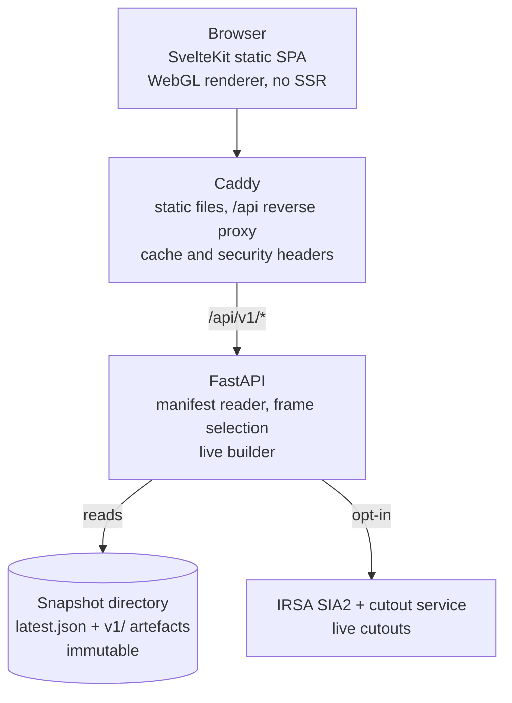

# Architecture

The service does not use a database, message queue, user accounts, or background workers. A scheduled command (ingest) imports the data and writes snapshots. The API only reads those snapshots. All configuration is read from `DRIFT_*` environment variables; see the reference in [Deployment](deployment.md#configuration-reference).

Below is a high-level diagram of DRIFT's architecture. Note that DRIFT never creates data while serving a request. The browser only displays published artefacts or data from an opt-in request to IRSA.



## Reasoning

The browser should (obviously) not be performing any computations, but the server should also not be keeping an in-memory context for each client. Therefore, the server sends image planes, and the browser only renders them. Specifically:

- The server chooses which visits and which band make up a stack; opens matching planes; computes a display window for the stack and returns per-frame metadata.
- The browser decodes the planes, applies the window, applies the tone curve, and composites.

## The snapshot

A snapshot is a versioned, immutable set of processed artefacts and a manifest. `latest.json` is the only file that ever changes in the snapshot directory. Self-explanatory, but it points to the current snapshot:

```json
{
  "snapshot_id": "20261116T025759Z-b9b213ba",
  "manifest": "v1/20261116T025759Z-b9b213ba/manifest.json",
  "published_at": "2026-11-16T02:58:07.947927Z"
}
```

The manifest works as the interface between ingestion and the application. It contains the snapshot ID, its targets, each target's visits and epochs, the computed bands and windows, an eligibility flag and reason for each mode, and a file entry for every image plane.

The eligibility flags/reasons are for the UI to explain why a view is unavailable. They're set by the API instead of the UI, so the API can give more specific reasons to the UI. `timeline`, `survey_compare`, and `spectrum` each include an `available` flag and a reason when the mode is unavailable.

For the time being, `spectrum` is not yet implemented and will be unavailable.

## Planes

Image planes are stored in a special container named `SPX1`. The container consists of a 32-byte little-endian header followed by row-major `float16` data. The header contains the magic value, format version, data type, dimensions, scale and offset, CRC32, and frame index.

`float16` are used to preserve more precision for the difference images to at least somewhat useful. Planes are compressed during transfer and cached immutably.

Every frame in a band stack uses the same window and window hash.

## API surface

All routes are under `/api/v1` and use the app's origin.

| Route | Purpose |
| --- | --- |
| `GET /health` | `snapshot_id`, `snapshot_age_s`, `plane_count`, `disk_free_bytes` |
| `GET /manifest` | The current manifest, plus live-path flags |
| `GET /targets` | Manifest targets in display order |
| `GET /targets/{target_id}` | One target's detail, including mode eligibility |
| `GET /targets/{target_id}/frames` | A frame stack (`mode`, `bins`, `band`, `visits`, `reference`, `visit`, `epochs`) |
| `GET /resolve` | Live resolution for arbitrary coordinates (`ra`, `dec`, `fov`, `bins`, `target`) |
| `GET /live/{token}/{filename}` | Cached planes produced by a live resolution |
| `GET /snapshots/{id}/planes/{filename}` | A published plane, immutable |
| `GET /snapshots/{id}/derived/{filename}` | A derived plane (for example a difference), cached |

## Live resolution

You can also request coordinates that aren't part of a published snapshot. This is turned on by default and can be disabled with `DRIFT_LIVE_ENABLED=false`. With it enabled, the service:

- Checks the coordinates before contacting the archive, so bad input is rejected immediately.
- Limits how often each client can make requests and how many archive requests can run at the same time.
- Enforces `DRIFT_LIVE_TIMEOUT_S` across the whole resolution. If the archive returns `503 Server busy`, it retries after a short delay.
- Caches resolved timelines for a short time and keeps generated planes immutable. Requesting the same view again can therefore use the existing result.
